# TP Intégration et Déploiement Continu — Pipeline data


**Auteure :** Amelia Boukri , MELISSA BELKESSAM — **Dépôt :** https://github.com/ameliaboukri/tp-cicd

Pipeline data automatisée qui génère des transactions financières (CSV, images, textes), les stocke dans un S3 local, les charge, les valide, les traite et les insère dans PostgreSQL. Toute la chaîne est testée et exécutée automatiquement par une CI GitHub Actions à chaque push.

**Niveaux réalisés :** Niveau 1 (pipeline locale) ✅ · Niveau 2 (stockage S3) ✅ · Niveau 3 : **Option 2 (OCR)** ✅ et **Option 3 (SLM)** ✅

---

## Sommaire

1. [Architecture](#architecture)
2. [Stack technique](#stack-technique)
3. [Structure du dépôt](#structure-du-dépôt)
4. [Lancer le projet](#lancer-le-projet)
5. [Niveau 1 — Pipeline data locale](#niveau-1--pipeline-data-locale)
6. [Niveau 2 — Stockage S3](#niveau-2--stockage-s3)
7. [Niveau 3 — Améliorations (OCR + SLM)](#niveau-3--améliorations-ocr--slm)
8. [Tests automatiques](#tests-automatiques)
9. [Pipeline CI](#pipeline-ci)
10. [Problèmes réels rencontrés et corrections](#problèmes-réels-rencontrés-et-corrections)
11. [Limites et améliorations possibles](#limites-et-améliorations-possibles)

---

## Architecture

```
  Génération (données déterministes)
  ┌──────────┬──────────────┬──────────────┐
  │   CSV    │  Images PNG  │  Textes TXT  │
  └────┬─────┴──────┬───────┴──────┬───────┘
       └────────────┼──────────────┘
                    ▼  upload + vérification
          ┌───────────────────┐
          │  S3 (SeaweedFS)   │  bucket "transactions", préfixe incoming/
          └─────────┬─────────┘
                    ▼  téléchargement (retry)
          hash SHA-256 ── déjà dans processed_files ? ──▶ SKIP
                    │ non
                    ▼  chargement selon le type
     ┌──────────────┼──────────────────────┐
     │ .csv         │ .png                 │ .txt
     │ loader CSV   │ OCR (Tesseract)      │ SLM (Ollama, qwen2.5:1.5b)
     └──────────────┴──────────┬───────────┘
                               ▼
              Validation (parse_row commun aux 3 sources)
                               ▼
              Traitement (fonctions pures : sommes + flag > 5000)
                               ▼
              Insertion PostgreSQL (1 transaction SQL par fichier, retry)
```

Les trois sources rejoignent **le même flux** dès l'étape de validation : une image ou un texte devient une transaction au même format qu'une ligne de CSV.

## Stack technique

| Rôle | Outil |
|---|---|
| Langage | Python 3.14 |
| Base de données | PostgreSQL 17 (Docker) |
| Stockage objet | SeaweedFS, compatible S3 (Docker), client `boto3` |
| OCR | Tesseract 5 + `pytesseract`, images générées avec `Pillow` |
| SLM | Ollama (Docker) + modèle `qwen2.5:1.5b` (~1 Go) |
| Tests | `pytest` (41 tests) |
| Orchestration locale | Docker Compose |
| CI | GitHub Actions |

## Structure du dépôt

```
tp-cicd/
├── generator/
│   ├── generate_csv.py        # CSV de transactions (référence + aléatoire à graine fixe)
│   ├── generate_images.py     # images d'ordres de virement (OCR)
│   └── generate_texts.py      # textes libres (SLM), dont l'exemple exact du sujet
├── pipeline/
│   ├── loader.py              # chargement + validation des CSV (parse_row commun)
│   ├── processing.py          # traitements : fonctions PURES
│   ├── db.py                  # schéma, anti-doublons, insertion transactionnelle
│   ├── storage.py             # accès S3 (bucket, upload, vérification, téléchargement)
│   ├── retry.py               # mécanisme de retry générique
│   ├── ocr.py                 # Option 2 : image -> OCR -> extraction -> validation
│   ├── slm.py                 # Option 3 : texte -> SLM -> validation / transformation
│   └── main.py                # pipeline complète (5 étapes)
├── sql/schema.sql             # 5 tables
├── tests/                     # 41 tests (unitaires + intégration)
├── docker-compose.yml         # PostgreSQL + SeaweedFS + Ollama
├── requirements.txt
└── .github/workflows/ci.yml   # pipeline CI
```

## Lancer le projet

Prérequis : Docker Desktop, Python 3.12+, Tesseract ([installeur Windows](https://github.com/UB-Mannheim/tesseract/wiki) ou `winget install UB-Mannheim.TesseractOCR`).

```powershell
python -m venv .venv
.venv\Scripts\Activate.ps1
pip install -r requirements.txt

docker compose up -d --wait                          # PostgreSQL + S3 + Ollama
docker exec tp_ollama ollama pull qwen2.5:1.5b       # modèle SLM (une seule fois)

python -m pipeline.main                              # pipeline complète
python -m pytest -v                                  # 41 tests
```

Options utiles de `pipeline.main` : `--no-generate`, `--max-retries N`, `--retry-delay S`, `--simulate-db-failures N`, `--simulate-s3-failures N`.

---

## Niveau 1 — Pipeline data locale

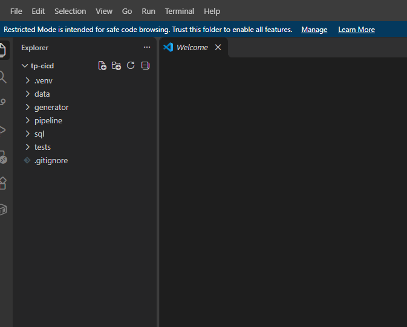

### 1. Génération des données CSV

`generator/generate_csv.py` génère plusieurs fichiers de **5 à 10 transactions** au format demandé (`datetime_transaction`, `iban_origine`, `pays_source`, `banque_source`, `iban_destinataire`, `pays_destinataire`, `montant`).

Pour que la pipeline soit **testable**, les données ne sont pas totalement aléatoires :

- **un fichier de référence** `transactions_000.csv` écrit à la main, dont tous les résultats sont connus d'avance. Il contient des cas limites : un montant à **5000.00 pile** (ne doit pas être flaggé), un à **5000.01** (doit l'être), et un IBAN qui envoie plusieurs fois ;
- **des fichiers pseudo-aléatoires** générés avec une **graine fixe** (`seed=42`) : chaque exécution produit exactement les mêmes données ;
- **une liste fixe de comptes** : un IBAN a toujours le même pays et la même banque.

| Vérification sur le fichier de référence | Résultat attendu |
|---|---|
| Somme envoyée par `FR7630006000011234567890189` | 8500.50 |
| Somme reçue par `DE89370400440532013000` | 6200.00 |
| Transactions flaggées | 5000.01 et 7500.00 (pas 5000.00) |

### 2. Chargement et traitement des données

- **Chargement** (`pipeline/loader.py`) : lecture du CSV, vérification des colonnes, conversion des types (date, `Decimal` pour les montants afin d'éviter les erreurs d'arrondi des `float`) et rejet des lignes invalides (date invalide, montant non numérique ou ≤ 0, champ vide).
- **Traitement** (`pipeline/processing.py`) : somme envoyée par `iban_origine`, somme envoyée par `banque_source`, somme reçue par `iban_destinataire`, et flag si `montant > 5000`.

Les fonctions de chargement sont **séparées** des fonctions de traitement, et les fonctions de traitement sont **pures** : elles ne lisent aucun fichier, ne dépendent d'aucun état externe et ne modifient pas leur entrée (le flag est ajouté sur une **copie** de chaque transaction avec `{**t, "flag": ...}`). Le test `test_fonctions_pures` le vérifie : même entrée → même résultat, et entrée inchangée après l'appel.

### 3. Base de données relationnelle

PostgreSQL, schéma dans `sql/schema.sql` :

| Table | Contenu |
|---|---|
| `processed_files` | fichiers traités : nom, **hash SHA-256 (UNIQUE)**, nombre de transactions, date |
| `transactions` | transactions détaillées + `flag` + clé étrangère vers le fichier d'origine |
| `sent_by_iban` | somme envoyée par IBAN émetteur |
| `sent_by_bank` | somme envoyée par banque |
| `received_by_iban` | somme reçue par IBAN destinataire |

Les sommes **se cumulent d'un fichier à l'autre** (`INSERT ... ON CONFLICT DO UPDATE SET total = total + EXCLUDED.total`). L'insertion d'un fichier se fait dans **une seule transaction SQL** : en cas d'erreur, rien n'est enregistré (tout ou rien).

### 4. Pipeline complète

`python -m pipeline.main` enchaîne automatiquement toutes les étapes : génération des fichiers, mise en place de la base (création des tables si besoin), chargement, traitement et insertion. En cas d'erreur, le script s'arrête avec le **code de sortie 1**, ce qui fait échouer la CI. La CI exécute cette pipeline à chaque push.

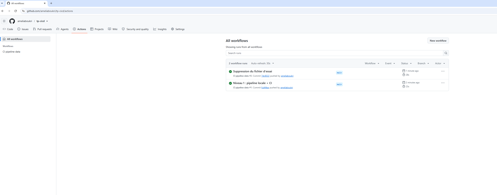

### 5. Tests d'intégration automatiques

Les tests lancent la **vraie pipeline** sur une **vraie base** (vidée avant chaque test), puis vérifient en base :

| Exigence du sujet | Test |
|---|---|
| les données sont bien insérées | `test_donnees_inserees` |
| les valeurs enregistrées sont correctes | `test_valeurs_enregistrees` |
| les traitements produisent les résultats attendus | `test_sommes`, `test_plusieurs_fichiers_coherents` (sommes en base = sommes recalculées directement depuis les CSV bruts) |
| les flags sont correctement positionnés | `test_flags` |
| un fichier n'est pas traité deux fois | `test_pas_de_double_traitement` |

Ils sont exécutés automatiquement dans la CI (étape « Lancer les tests »).

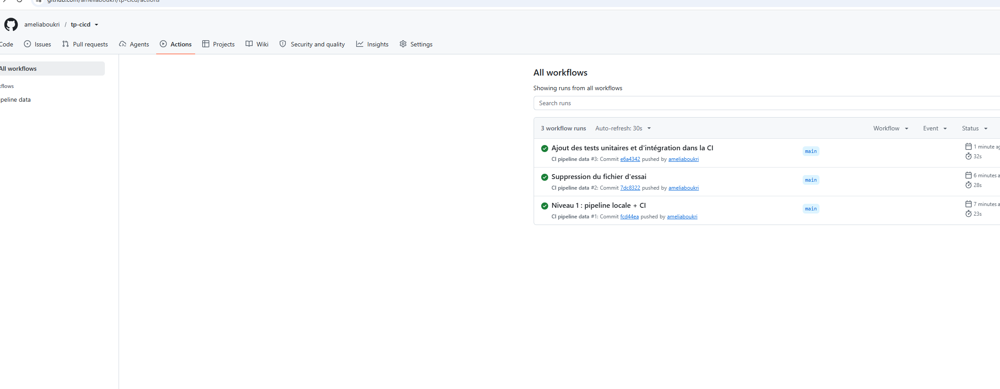

### 6. Simulation d'un échec de pipeline

**Scénario : erreur dans le traitement.** Le sujet demande de flagger les montants **supérieurs** à 5000. On introduit volontairement le bug classique de borne : `>=` au lieu de `>`.

**1. Cause du problème** — commit `d10f4be` : la condition du flag devient `t["montant"] >= threshold`. On voit déjà la croix rouge `0/1` (CI échouée) sous le titre du commit.

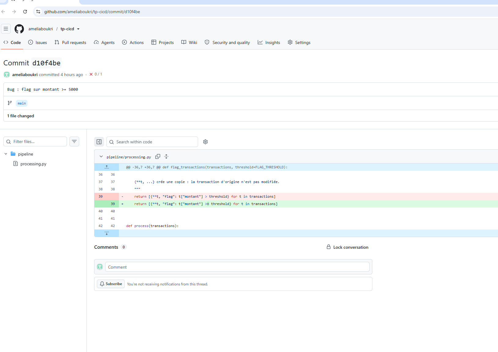

**2. Échec de la pipeline** — la CI passe au rouge.

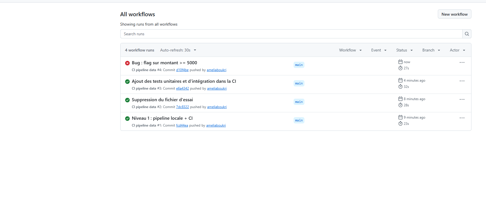

**3. Message d'erreur obtenu** — 2 tests échouent :

- `test_flag_strictement_superieur_a_5000` : attendu `[False, False, True, False]`, obtenu `[False, False, True, True]`. Le diff indique `At index 3 diff: True != False` : la 4ᵉ transaction, à **5000.00 pile**, est flaggée à tort ;
- `test_flags` (intégration) : le même défaut est constaté **en base** (`assert True is False`).

Pytest renvoie le code 1 (`2 failed, 13 passed`), et les étapes suivantes de la CI (exécution de la pipeline) sont **sautées** : aucune donnée erronée n'est insérée. C'est précisément le cas limite à 5000.00 prévu dans les données de référence qui a permis de détecter le bug.

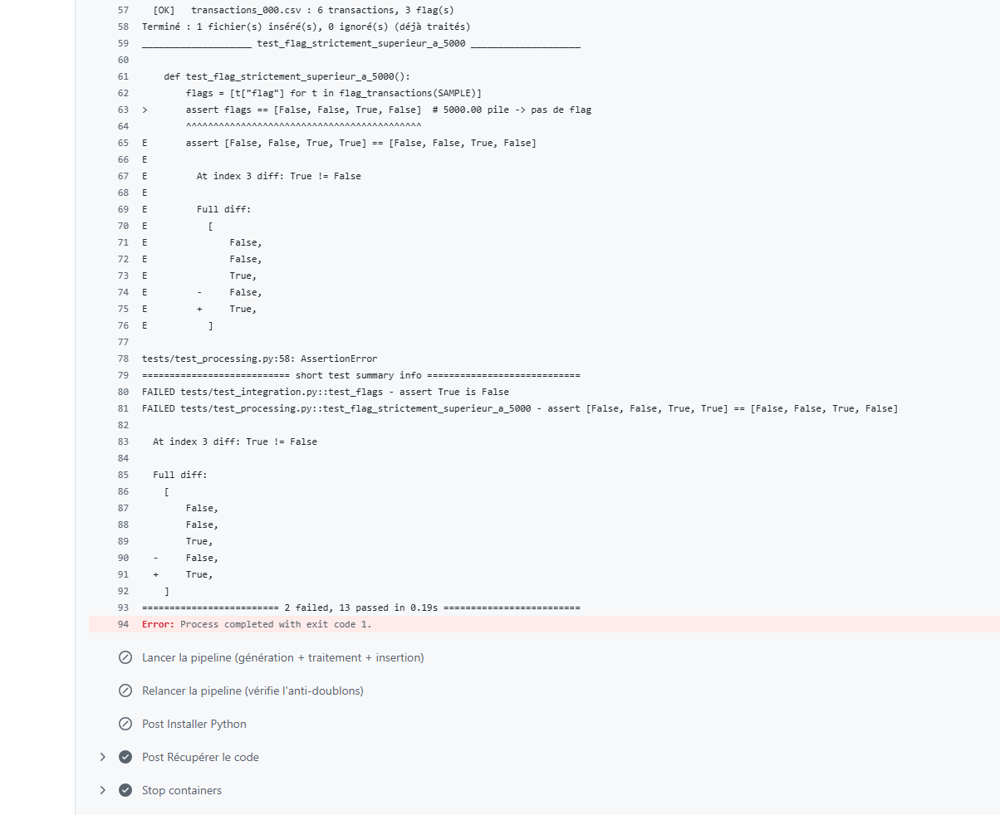

**4. Correction apportée** — commit `2f36c4e` : retour à la condition stricte `>` (coche verte `1/1` sous le titre).

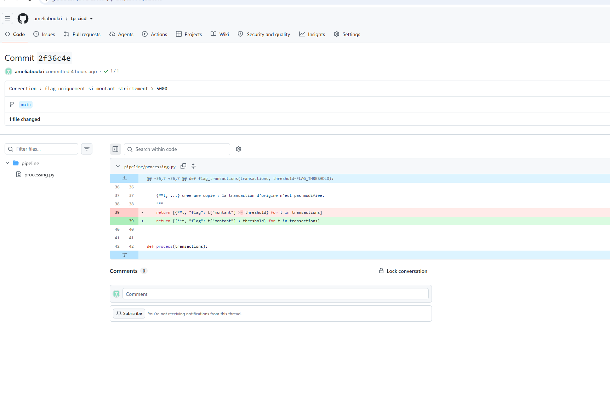

**5. Réussite de la pipeline après correction** — la CI repasse au vert ; l'historique montre le rouge puis le vert.

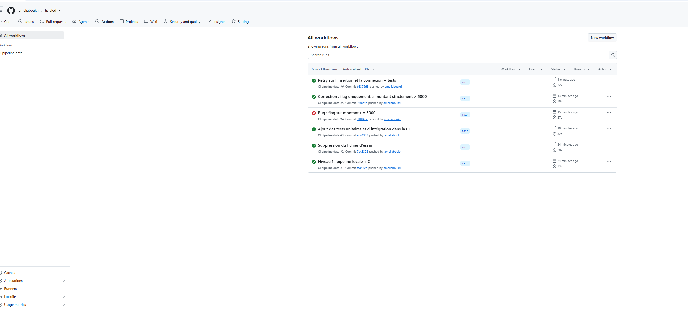

### 7. Retry lors de l'insertion en base

`pipeline/retry.py` contient un mécanisme générique, réutilisé pour la base, le S3 et le SLM.

| Exigence | Mise en œuvre |
|---|---|
| détecter l'échec | on intercepte les erreurs temporaires (`psycopg.OperationalError`, panne simulée) |
| attendre avant une nouvelle tentative | `time.sleep`, délai qui double à chaque échec (1 s, 2 s, 4 s…) |
| plusieurs tentatives / maximum | paramètre `--max-retries` (3 par défaut) |
| arrêter la pipeline si dépassé | `RetryError` → message `abandon après N tentatives` et code de sortie 1 |
| afficher clairement les erreurs | une ligne `[ERREUR] ... tentative 1/3 échouée : <type>: <message>` par échec |

**Simulation :** `--simulate-db-failures N` fait échouer les N prochaines insertions. La panne est déclenchée **au milieu** de l'insertion (après l'écriture des transactions) pour prouver que le rollback annule tout.

**2 pannes → réussite à la 3ᵉ tentative :**

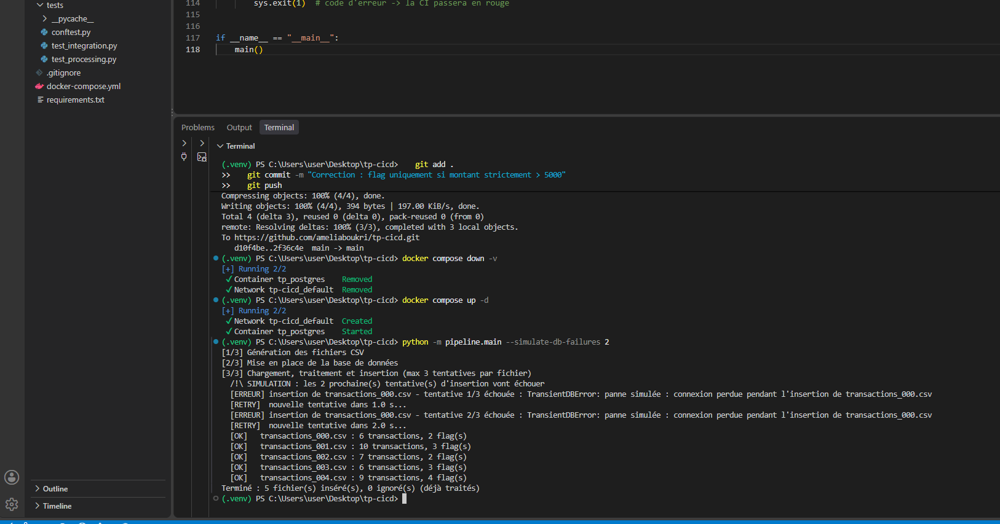

**Aucun doublon malgré les retries** (chaque fichier une seule fois dans `processed_files`) :

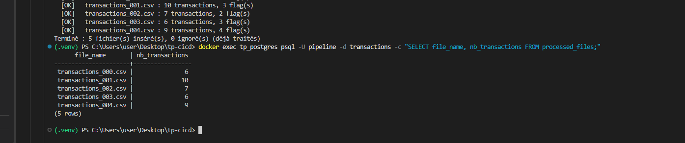

**5 pannes → abandon après 3 tentatives, code de sortie 1, `COUNT = 0`** (le rollback a tout annulé) :

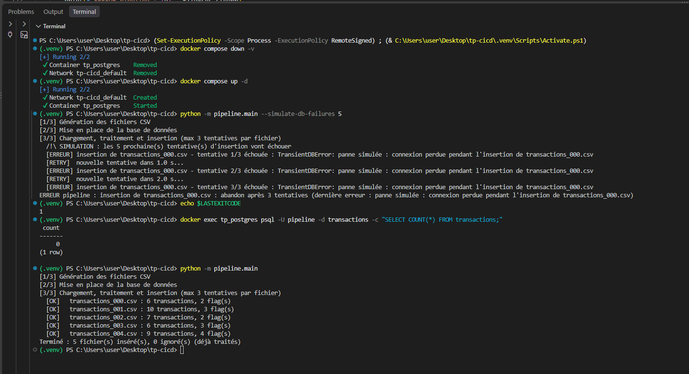

**Cas réel découvert pendant la démo :** lancer la pipeline juste après `docker compose up` a échoué car PostgreSQL n'avait pas fini de démarrer (`server closed the connection unexpectedly`). La **connexion initiale** a donc aussi reçu un retry (5 tentatives).

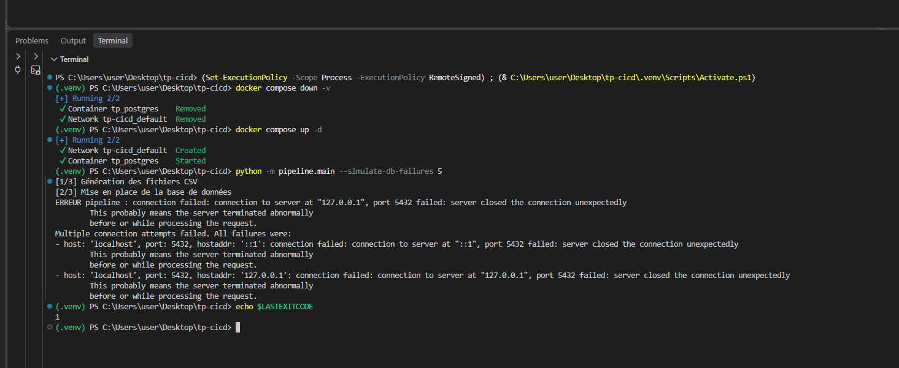

#### Éviter les doublons

Un fichier déjà traité avec succès n'est jamais retraité, y compris avec le retry, grâce à 3 protections :

1. **Hash SHA-256 du contenu** comparé à la table `processed_files` avant tout traitement (un même contenu sous un autre nom est aussi reconnu, cf. `test_anti_doublon_par_contenu`) ;
2. **Insertion transactionnelle** : un fichier est enregistré dans `processed_files` dans la **même transaction** que ses données. Une tentative échouée ne laisse donc aucune trace, et une tentative réussie marque le fichier comme traité ;
3. **Contrainte `UNIQUE`** sur `file_hash` : filet de sécurité au niveau de la base. Avant chaque nouvelle tentative, on revérifie aussi si le fichier n'a pas déjà été inséré.

---

## Niveau 2 — Stockage S3

### 1. Stockage dans un service compatible S3

Service retenu : **SeaweedFS**, lancé dans Docker (`docker-compose.yml`, port 8333), avec un healthcheck. Le code utilise `boto3`, donc il fonctionnerait tel quel avec n'importe quel S3.

### 2. Upload automatique dans le S3

La pipeline suit les 5 étapes demandées :

```
[1/5] Connexion au S3 et préparation du bucket
  bucket 'transactions' créé
[2/5] Génération des fichiers CSV
[3/5] Envoi des CSV dans le S3 et vérification
  5 fichier(s) envoyé(s) et présent(s) dans le S3
[4/5] Mise en place de la base de données
[5/5] Récupération depuis le S3, chargement, traitement et insertion (max 3 tentatives)
  [OK]   incoming/transactions_000.csv : 6 transactions, 2 flag(s)
  [OK]   incoming/transactions_001.csv : 10 transactions, 3 flag(s)
  ...
Terminé : 5 fichier(s) inséré(s), 0 ignoré(s) (déjà traités)
```

- le service S3 est démarré en début de pipeline (`docker compose up -d --wait`, en local comme en CI) ;
- le bucket est créé s'il n'existe pas (`ensure_bucket`, idempotent) ;
- les fichiers générés sont envoyés dans `incoming/` ;
- `verify_uploaded` vérifie que chaque fichier envoyé est bien présent, sinon la pipeline s'arrête.

Vérification directe dans le stockage (`curl http://localhost:8333/transactions/`) :

```xml
<ListBucketResult><Name>transactions</Name>...
  <Contents><Key>incoming/transactions_000.csv</Key><Size>756</Size>...</Contents>
  <Contents><Key>incoming/transactions_001.csv</Key><Size>1164</Size>...</Contents>
  ... (5 fichiers)
</ListBucketResult>
```

### 3. Lecture des données depuis le S3

Le traitement **ne lit plus le système de fichiers local** : il liste les fichiers du bucket et les télécharge (`download_bytes`) avant de les charger. Le flux est bien **S3 → récupération → chargement → traitement → base**. Le test `test_traitement_ne_depend_pas_du_local` supprime les fichiers locaux après l'upload et vérifie que la pipeline traite quand même tout depuis le S3.

L'anti-doublons fonctionne toujours : le hash est calculé sur le contenu téléchargé depuis le S3.

### 4. Retry lors de la récupération depuis le S3

Même mécanisme `retry()`. Erreurs considérées comme temporaires : connexion impossible ou timeout de connexion (`botocore.exceptions.ConnectionError`, qui inclut `EndpointConnectionError`), coupure ou timeout de lecture (`HTTPClientError`), et la panne simulée (`--simulate-s3-failures N`).

**Panne simulée temporaire → réussite :**

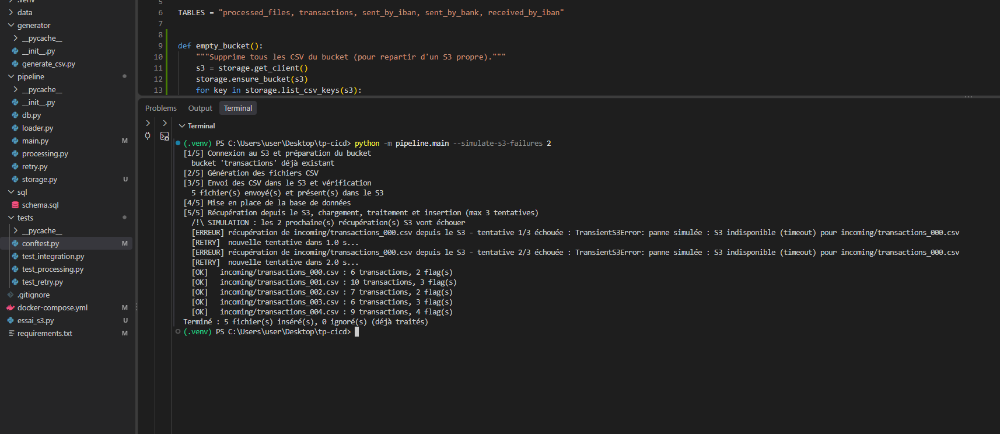

**Vraie panne, première version :** avec le conteneur S3 réellement arrêté (`docker compose stop s3`), la pipeline s'arrêtait **sans aucun retry**. L'erreur `EndpointConnectionError` n'appartenait pas à la famille d'erreurs déclarée comme temporaire (voir [Problèmes réels](#problèmes-réels-rencontrés-et-corrections)).

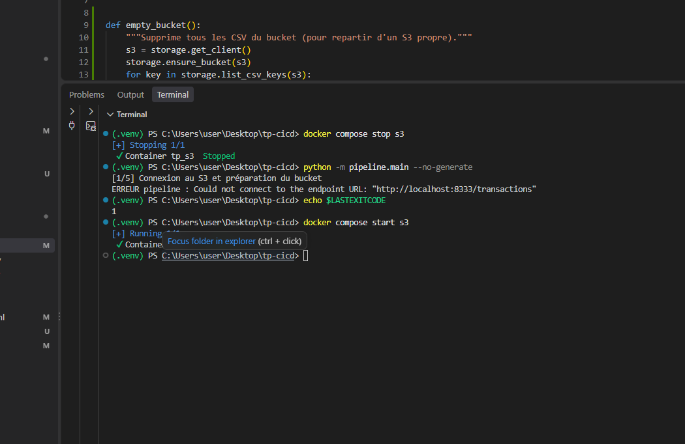

**Vraie panne, après correction → 5 tentatives (1 s, 2 s, 4 s, 8 s) puis arrêt propre, code de sortie 1 :**

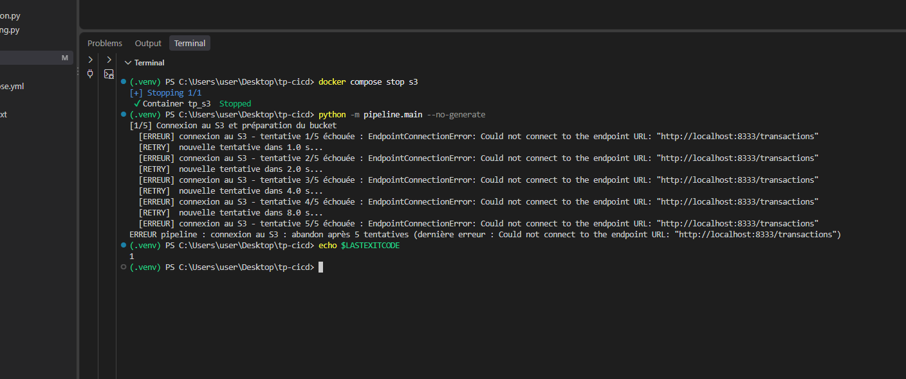

Lors d'un redémarrage du S3 pendant les retries, l'erreur change de nature, ce qui montre que les deux familles d'erreurs réseau sont gérées :

```
[ERREUR] connexion au S3 - tentative 1/5 échouée : EndpointConnectionError: Could not connect to the endpoint URL ...
[ERREUR] connexion au S3 - tentative 2/5 échouée : ConnectionClosedError: Connection was closed before we received a valid response ...
```

La 1ʳᵉ erreur indique que rien n'écoute (conteneur éteint), la 2ᵉ que le conteneur a redémarré mais que le service n'est pas encore prêt : **conteneur démarré ≠ service prêt**.

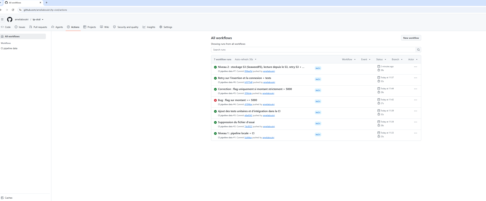

---

## Niveau 3 — Améliorations (OCR + SLM)

Options retenues : **Option 2 (OCR)** et **Option 3 (SLM)**. Elles tournent entièrement en local et dans la CI, sans service cloud payant. Les deux produisent des transactions au même format qu'une ligne de CSV, qui rejoignent ensuite le même flux (S3, anti-doublons, traitement, base, retry).

### Option 2 — Extraction de transactions depuis des images (OCR)

Le module `pipeline/ocr.py` suit le schéma du sujet :

| Étape | Fonction |
|---|---|
| Image → OCR | `ocr_image()` : Tesseract, image convertie en niveaux de gris |
| Extraction des informations | `extract_fields()` : une expression régulière par champ (`IBAN emetteur : ...`) |
| Validation / Transformation | nettoyage des défauts de l'OCR, contrôle du format IBAN, puis **le même `parse_row()` que les CSV** |

`generator/generate_images.py` produit des images d'ordres de virement **connues d'avance**, dont l'exemple du sujet (FR → DE, 6200 €) et un montant à 5000.00 pile :

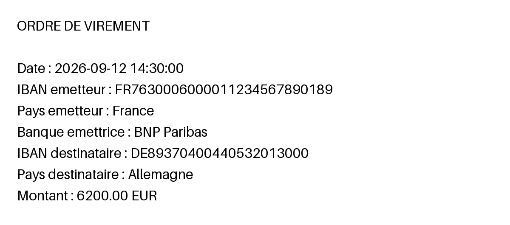

**Pourquoi l'étape de transformation est indispensable :** pendant les tests, Tesseract a réellement lu `Montant:` sans l'espace et a coupé un IBAN en deux (`FR763000600001 1234567890189`). La transformation supprime les espaces des IBAN et normalise les montants (`6 200,00 EUR` → `6200.00`). Ces défauts réels sont repris dans le test `test_extraction_et_transformation`.

**Résultat de l'OCR sur les 5 images :**

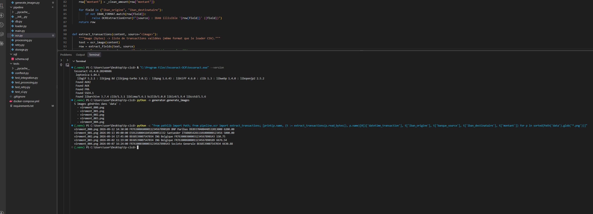

**Pipeline avec CSV + images :**

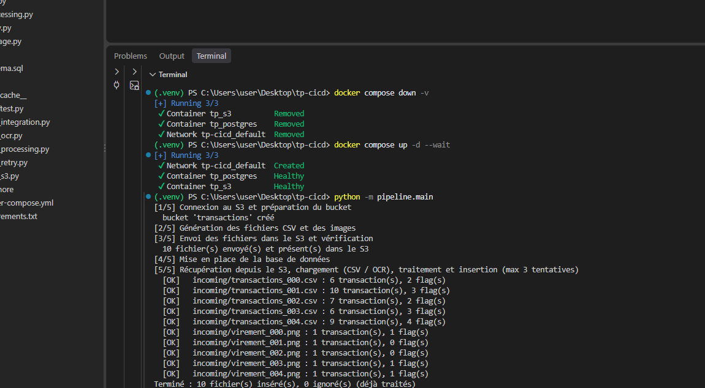

**Échec réel en CI :** la première CI de cette option a échoué avec `tesseract is not installed or it's not in your PATH` : Tesseract était installé sur le poste local mais pas sur la machine de la CI. Les tests OCR avaient été **sautés** (et non échoués), ce qui cachait le problème. Corrections : installation de Tesseract dans la CI, et variable `REQUIRE_TESSERACT=1` qui interdit de sauter ces tests en CI.

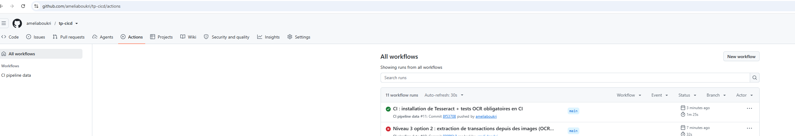

### Option 3 — Extraction depuis du texte avec un SLM

Le modèle **`qwen2.5:1.5b`** tourne localement avec **Ollama**, lancé dans Docker comme les autres services (identique en local et en CI). Il est appelé via l'API HTTP d'Ollama.

**Constat de départ :** interrogé librement, le modèle trouve les bonnes valeurs mais les entoure d'explications fausses (il affirme que l'IBAN émetteur est celui du destinataire), et sa réponse en texte libre n'est pas exploitable par un programme :

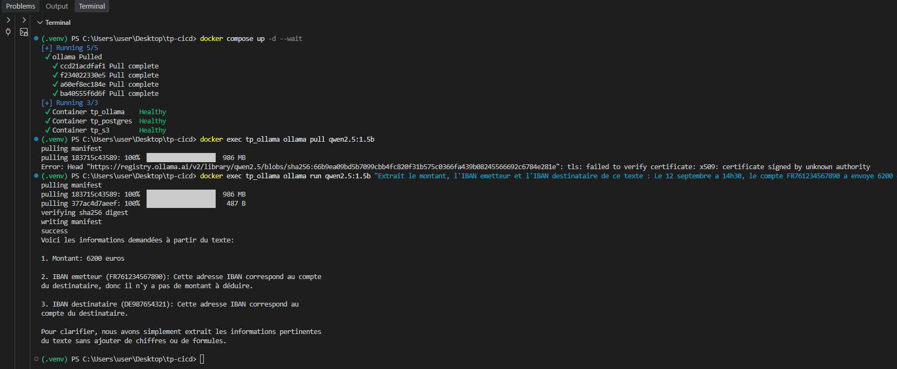

**Conception retenue** (`pipeline/slm.py`) :

1. **Réponse JSON imposée** (structured outputs d'Ollama) avec un schéma fixe : jour, mois, année, heure, minute, IBAN émetteur et destinataire, banque, montant ;
2. **Exemple question/réponse dans le prompt** (few-shot), température 0 et graine fixe pour des réponses reproductibles ;
3. **Le modèle ne fait que ce que le code ne sait pas faire** (comprendre « le 12 septembre à 14h30 »). Tout ce qui est déterministe est fait en Python : le **pays** est déduit du code de l'IBAN (`FR` → France, `DE` → Allemagne), l'**année** manquante est complétée par une valeur fixe, une **banque** non nommée devient `Inconnue` ;
4. **Garde-fous anti-hallucination** : chaque IBAN et le montant renvoyés doivent **apparaître dans le texte d'origine**, sinon la réponse est rejetée (testé avec un montant et un IBAN inventés) ; émetteur et destinataire doivent être différents ;
5. **Même `parse_row()`** que les CSV et les images.

**Réponses JSON obtenues** sur les 3 textes de référence (dont l'exemple exact du sujet, sans année ni banque, et un montant au format `1 250,50 €`) :

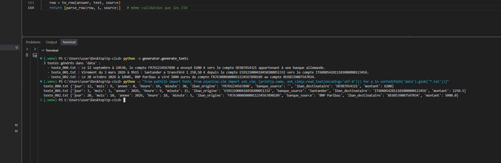

| Texte | Résultat après transformation |
|---|---|
| exemple du sujet | 2026-09-12 14:30, `FR761234567890` (France) → `DE987654321` (Allemagne), banque `Inconnue`, **6200.00** → flaggé |
| `1 250,50 €`, Santander | 2026-03-03 09:15, Espagne → Italie, **1250.50** |
| 5000 € pile, BNP Paribas | 2026-10-20 18:05, France → Belgique, **5000.00** → non flaggé |

Si Ollama est injoignable, l'extraction est **réessayée** avec le même mécanisme de retry.

### Résultat final : les 3 sources dans la même pipeline

13 fichiers (5 CSV, 5 images, 3 textes) envoyés dans le S3, puis chargés, traités et insérés :

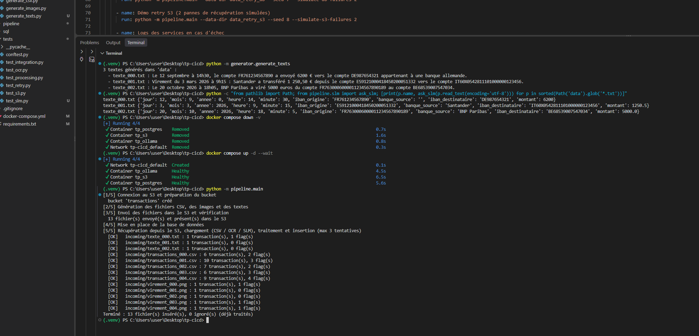

Seconde exécution : les 13 fichiers sont ignorés. Le hash étant vérifié **avant** l'extraction, ni l'OCR ni le modèle ne sont rappelés :

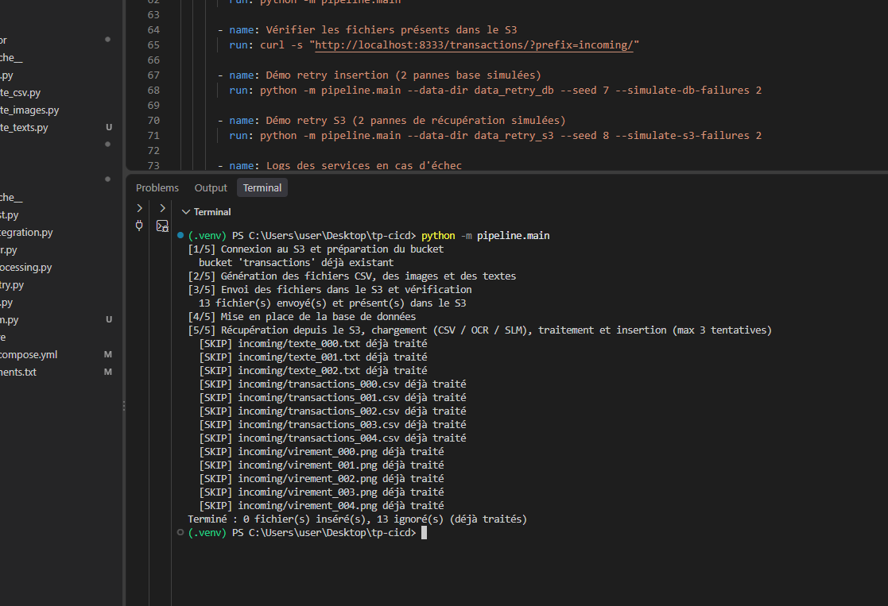

---

## Tests automatiques

**41 tests**, tous exécutés dans la CI :

| Fichier | Nb | Contenu |
|---|---|---|
| `test_processing.py` | 9 | sommes, seuil strict 5000, fonctions pures, rejet des CSV invalides |
| `test_integration.py` | 6 | pipeline réelle + vérifications en base (insertion, valeurs, sommes, flags, doublons) |
| `test_retry.py` | 6 | succès après pannes, délai doublé, maximum, erreurs non temporaires, rollback |
| `test_s3.py` | 7 | upload et présence, fichier manquant détecté, indépendance du local, anti-doublon par contenu, retry S3 simulé et réel |
| `test_ocr.py` | 6 | extraction et transformation (défauts OCR réels), champs/IBAN invalides, OCR réel, pipeline |
| `test_slm.py` | 7 | transformation de l'exemple du sujet, 3 garde-fous anti-hallucination, réponse incomplète, modèle réel, pipeline |

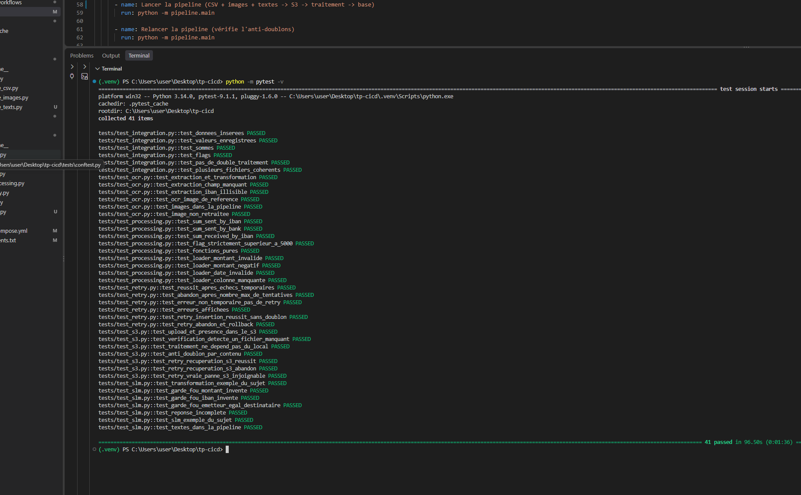

## Pipeline CI

`.github/workflows/ci.yml`, déclenchée à chaque push et pull request (et manuellement) :

1. récupération du code et installation de Tesseract ;
2. restauration du modèle SLM depuis le cache (évite de re-télécharger 1 Go) ;
3. démarrage de PostgreSQL, SeaweedFS et Ollama avec `docker compose up -d --wait` (même fichier qu'en local) puis téléchargement du modèle ;
4. installation de Python et des dépendances ;
5. **tests** (41) : en cas d'échec, la CI s'arrête avant d'insérer des données ;
6. **pipeline complète**, puis **seconde exécution** pour vérifier l'anti-doublons ;
7. vérification des fichiers présents dans le S3 ;
8. démonstrations des retries (pannes simulées en base et sur le S3) ;
9. en cas d'échec : affichage automatique des logs des services.

`REQUIRE_TESSERACT=1` et `REQUIRE_SLM=1` empêchent que des tests soient sautés silencieusement en CI.

## Problèmes réels rencontrés et corrections

| Problème | Détection | Correction |
|---|---|---|
| Bug `>=` au lieu de `>` (volontaire, étape 6) | tests unitaires + intégration en CI | condition stricte `>` |
| Pipeline lancée avant que PostgreSQL soit prêt | erreur de connexion en démo | retry sur la connexion initiale (5 tentatives) |
| `ensure_bucket` non idempotent avec SeaweedFS | 2ᵉ exécution en erreur `BucketAlreadyOwnedByYou` | création directe + gestion de « existe déjà » |
| S3 réellement éteint non réessayé (`EndpointConnectionError` hors de la liste des erreurs temporaires) | démo de vraie panne : aucun retry affiché | ajout de `botocore.exceptions.ConnectionError` + test `test_retry_vraie_panne_s3_injoignable` |
| Tesseract absent de la CI | CI rouge (`tesseract is not installed`) | installation dans la CI + tests OCR obligatoires |
| Réponse du SLM inexploitable et en partie fausse | premier essai du modèle | JSON imposé, few-shot, logique déterministe en Python, garde-fous |

Leçon principale : **une panne simulée ne remplace pas un vrai test de panne**. La démo avec le S3 réellement arrêté a révélé un défaut que les pannes simulées ne pouvaient pas montrer.

## Limites et améliorations possibles

- Les mots de passe sont en clair dans `docker-compose.yml` et la CI : à remplacer par des secrets (GitHub Secrets) pour une vraie production.
- Le SLM reste probabiliste : les garde-fous rejettent une réponse fausse mais ne la corrigent pas. Une file de « fichiers en erreur » permettrait de les traiter à part sans arrêter la pipeline.
- Un fichier invalide arrête la pipeline entière (choix volontaire pour que la CI échoue) ; en production, on pourrait l'isoler et continuer avec les autres.
- L'image Docker d'Ollama est volumineuse (3,8 Go) ; les options 1 (CD + Cron) et 4 (Terraform) seraient les suites logiques pour un déploiement réel.
